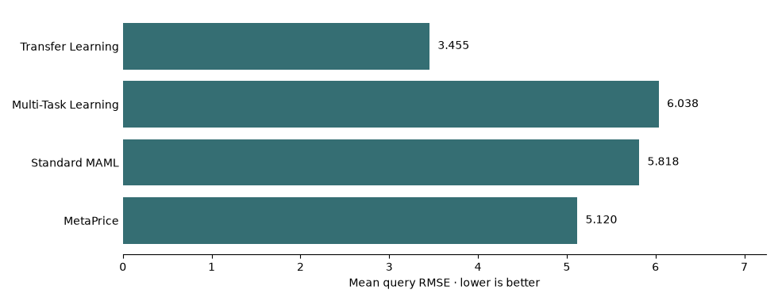
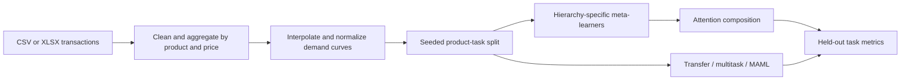

# MetaPrice

**Companion implementation for hierarchical meta-learning in few-shot price-demand modeling.**

MetaPrice trains demand predictors across product categories, price tiers, and elasticity
groups. The attention network combines their parameters into one task-specific
initialization before support-set adaptation. Transfer learning, multitask learning, and
standard MAML provide comparison paths.

## Quick start

Use Python 3.11 or newer with a compatible PyTorch installation. Run from the repository root:

```sh
python3 -m venv .venv
source .venv/bin/activate
python -m pip install -r requirements.txt
python main.py --config configs/paper.yaml --help
```

Dependencies require internet access. CPU is the default in `configs/default.yaml`;
training time depends on the dataset, model configuration, and hardware.

## Paper reproduction

Use `configs/paper.yaml` to run the method and hyperparameters stated in the paper.
The [reproduction guide](docs/reproduction.md) maps the implementation to the paper,
records the interpretation of conflicting statements, and separates published reference
values from measured results.

The checked-in [reproduction run](docs/reproduction-results.md) uses the official
UCI workbook and reports its measured values without treating them as paper results.

```sh
python main.py --config configs/paper.yaml --data_path path/to/online_retail_II.xlsx
```

Download the source dataset separately and retain its checksum and workbook metadata
with each run. Read the [data card](docs/data-card.md) before using external data. The
code does not claim that a new run matches the paper's values until the saved output
demonstrates it.

## Synthetic product holdout results

On the bundled 12-product synthetic fixture (6 training, 3 validation, 3 test), transfer learning had the lowest mean RMSE in the current-code run. MetaPrice measured 5.120 mean query RMSE. The product curves share a simple demand pattern. This comparison exercises adaptation on products withheld from training. Query points are interpolated from each product's complete observed curve, so they are not independent future transactions. It does not measure real-world pricing performance. Keep the [metrics](docs/results/metrics.json) and [split manifest](docs/results/synthetic-run-manifest.json) together. Regenerate the figure with `python scripts/render_synthetic_results.py` after updating the metrics from an actual run.



```sh
python main.py --config examples/synthetic/config.yaml --data_path examples/synthetic/transactions.csv
```

Run the same synthetic protocol across multiple explicit seeds and generate an aggregate
figure from the recorded metrics:

```sh
python scripts/run_synthetic_benchmark.py --seeds 17,29,43
python scripts/render_benchmark_results.py
```

The generated report stays under `outputs/` and is intentionally ignored by Git. Review
its raw per-seed manifests before deciding whether it supports any claim.

## Verification

```sh
python -m pip install -r requirements-dev.txt
python -m pytest tests -q
```

Tests cover preprocessing, input schema errors, configuration loading, adaptation, and
run-manifest integrity. CI also performs linting and package-build checks. It does not
reproduce full model training or validate pricing outcomes. See
[CONTRIBUTING.md](CONTRIBUTING.md) and [SECURITY.md](SECURITY.md).

## Train and inspect

```sh
python main.py --config configs/paper.yaml --data_path path/to/online_retail_II.xlsx --mode train
# Or provide an explicit CSV/XLSX path:
bash scripts/train.sh path/to/transactions.csv
```

Training includes baseline training, test-set evaluation, checkpoint export under
`outputs/`, and figures under `plots/`. Generated checkpoints and Python caches are
excluded from source control. Existing plots and metrics are retained as historical
artifacts; they are not independently reproduced benchmark evidence.

`--mode eval` loads saved weights and checks the input checksum, resolved
configuration, source-code hashes, checkpoint hashes, and product split against `outputs/run-manifest.json` before
writing `metrics-eval.json`. It does not retrain. `--mode infer` also verifies the
recorded dataset, configuration, split, and checkpoints, then recommends prices
for the first five held-out products using saved weights. It is a research
command, not a low-latency deployed inference service.

## Pipeline



Required columns are `StockCode`, `Quantity`, and `Price`; common aliases such as
`UnitPrice` are normalized. `Invoice` enables cancellation filtering and `Description`
supports heuristic category assignment. XLSX input requires `openpyxl`, included in
the requirements. External datasets retain their own distribution and usage terms.

The paper configuration admits products with at least three observed price points and
interpolates to `data.num_points`. Support points are taken from the beginning of each
sorted normalized curve. Interpolation and per-product demand normalization use the
complete observed curve before the support/query division. A query demand can therefore
affect the support representation and normalization. See the reproduction guide for
the documented interpretation.

## Repository guide

| Path | Purpose |
|---|---|
| `main.py` | Training, evaluation, and recommendation entry point |
| `configs/default.yaml` | Dataset, hierarchy, model, and optimization settings |
| `metaprice/preprocessing.py` | Cleaning, interpolation, and normalization |
| `metaprice/task_builder.py` | Few-shot tasks and seeded splits |
| `metaprice/trainer.py` | Hierarchy learners and attention training |
| `metaprice/baselines.py` | Comparison models |
| `metaprice/evaluate.py` | Evaluation metrics |
| `metaprice/inference.py` | Price-grid recommendation |

## Evaluation protocol and limitations

This is a research implementation, not a production pricing engine. Historical
transaction averages do not identify causal demand responses. Interpolation creates
synthetic curve points. Revenue based on a predicted curve is a model estimate, not
realized commercial uplift.

Before drawing conclusions, use a raw-observation temporal holdout with preprocessing
fit on support observations only, then repeat across seeds and compare against simple
demand baselines. The current curve-point evaluation cannot establish generalization to
unseen transactions or operational revenue. Every run writes input, source, checkpoint,
configuration, split, and runtime metadata to `run-manifest.json`; save the raw metrics
and aggregate statistics alongside it.
No production performance or revenue claim is made.

## License

Read the [data card](docs/data-card.md) and [changelog](CHANGELOG.md) before interpreting
experimental outputs.

[MIT License](LICENSE) for the project code. Third-party software, models, and datasets retain their own terms.
